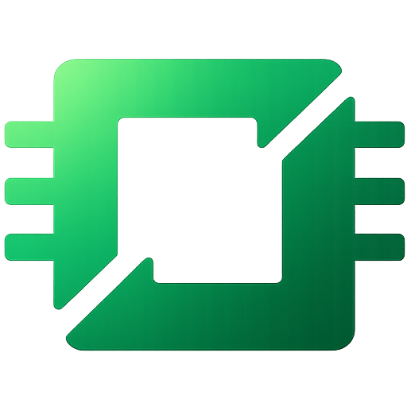

# Off Grid AI

**Your own AI, on the phone and computer you already have.** It's private, it works offline, and you pay once instead of every month.

Hundreds of thousands of people have downloaded it, it hit #1 on Hacker News, and the apps are open source.

 

<picture>
  <source media="(prefers-color-scheme: dark)" srcset="https://raw.githubusercontent.com/off-grid-ai/.github/main/profile/platforms/supported-dark.svg">
  
</picture>

**[Get it free on your phone](https://getoffgridai.co/download/?utm_source=github&utm_medium=org-readme)** · **[Get it free on your computer](https://getoffgridai.co/download/?utm_source=github&utm_medium=org-readme)** · **[See Pro](https://getoffgridai.co/pro/?utm_source=github&utm_medium=org-readme)**

---

## Pick what you need

| For | Get | What you get |
|---|---|---|
| **Your phone** | [Off Grid AI Mobile](https://github.com/off-grid-ai/OGAM) · free | Chat, ask about photos, talk, and make images on your iPhone or Android phone, even in airplane mode. [App Store](https://apps.apple.com/us/app/off-grid-local-ai/id6759299882) · [Google Play](https://play.google.com/store/apps/details?id=ai.offgridmobile) |
| **Your computer** | [Off Grid AI Desktop](https://github.com/off-grid-ai/OGAD) · free | A private assistant for macOS, Windows and Linux that works with your files, plus an OpenAI-compatible API so your other apps can use your local models. [Download](https://getoffgridai.co/download/?utm_source=github&utm_medium=org-readme) |
| **Everything you do** | [Off Grid AI Pro](https://getoffgridai.co/pro/?utm_source=github&utm_medium=org-readme) · one payment | It remembers your meetings and work, syncs your phone and computer, drafts actions you approve, and turns a sentence into a short film. One key covers up to five devices, and it replaces the separate AI subscriptions you pay for every month. |
| **Your apps** | [Off Grid AI Boost](https://getoffgridai.co/boost/?utm_source=github&utm_medium=org-readme) · flat price | The newest open models, like Qwen and DeepSeek, on our GPUs. One key for every model, one flat monthly price, no per-token bills, and your prompts are never stored or trained on. |
| **Your company** | [Off Grid AI Console](https://github.com/off-grid-ai/OGAC) · open source | Run your company's AI on servers you own. Every model sits behind one gateway, you set the rules once, and anyone on your team can build apps in plain language. |
| **Your coding agent** | [Off Grid AI Skills](https://github.com/off-grid-ai/skills) · free | 49 skills that make Claude Code, Codex, Cursor and 60+ other agents build, test and ship like a senior team. |
| **Your small business** | [Design partners](https://getoffgridai.co/design-partners/?utm_source=github&utm_medium=org-readme) · free | Under 50 people? Show us a task that eats your week and we'll build the fix with you. Setup is free, and you keep lifetime access to what we build. |

## Why people switch

- **It's yours.** Models run on your device, there's no account, and your chats and files stay with you.
- **It works anywhere.** On a plane, on a locked-down network, in any country.
- **You stop paying every month.** One Pro payment covers what you'd otherwise pay several AI apps for, like meeting notes, dictation and memory.
- **You can check every claim.** The apps are open source, so you can read exactly what they do.

## Join us

Ask questions and see what's coming in [Slack](https://join.slack.com/t/off-grid-mobile/shared_invite/zt-494gbuv5c-kj9tT7U0AS8Kq8UUO63_jw) or on [Reddit](https://reddit.com/r/off_grid_ai). Found a bug or want a feature? Open an issue or a pull request in the product's repo, and star it if it helps you.

<b>BUILT BY</b> <a href="https://wednesday.is/?utm_source=github&utm_medium=offgrid-org-readme&utm_content=logo">Wednesday Solutions</a>
